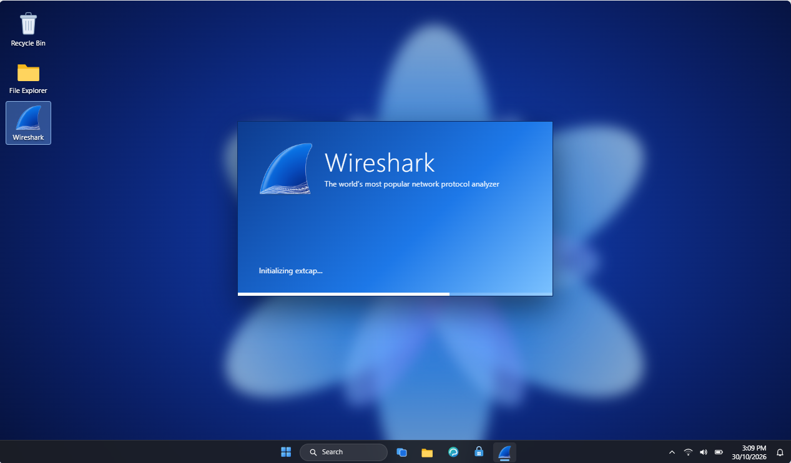
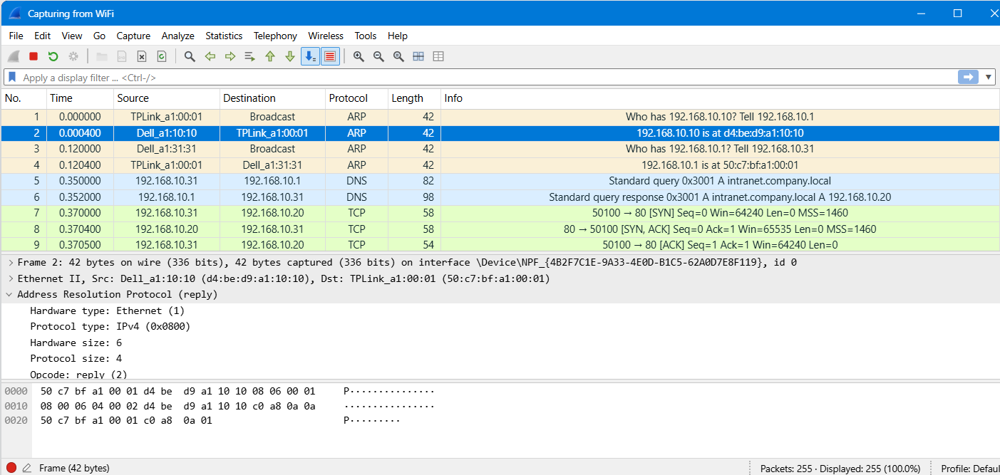
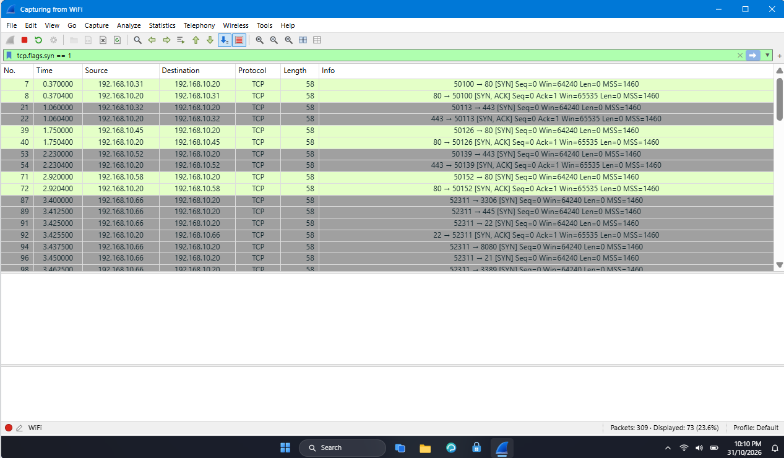
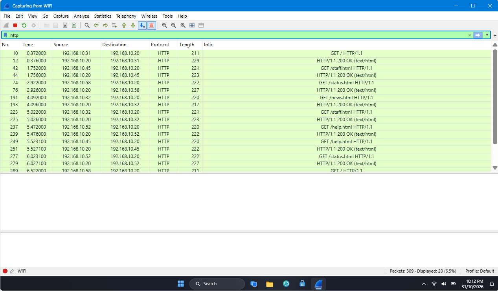
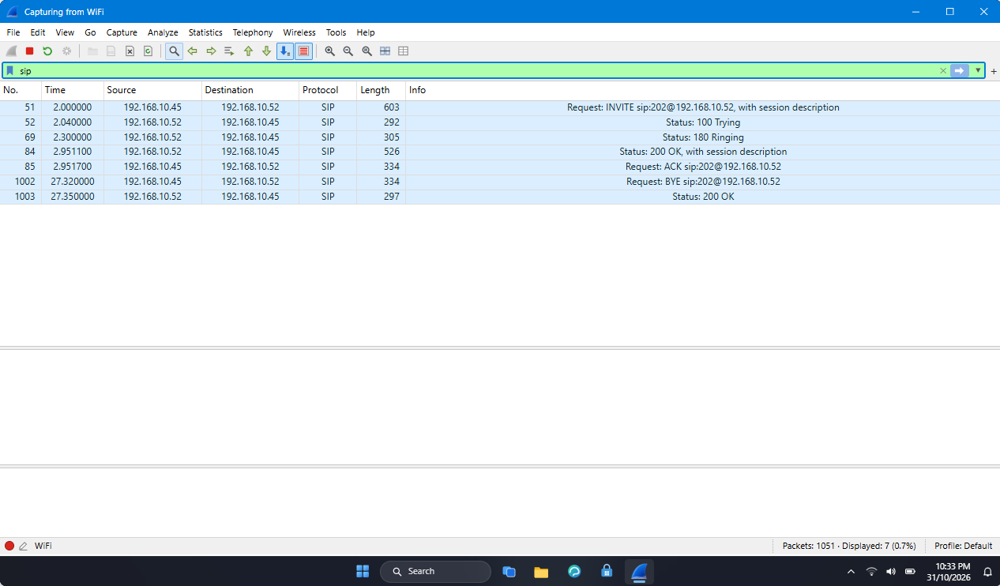
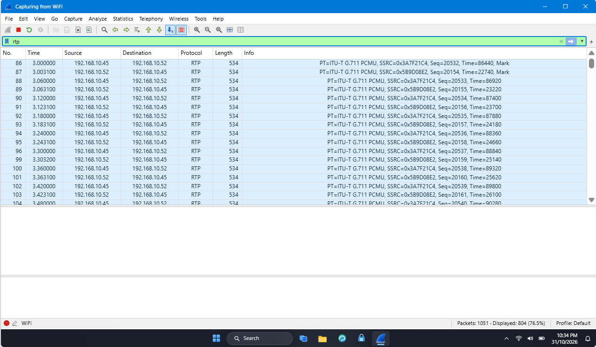

<div align="center">

# 🦈Wireshark SOC Lab – Network Traffic Analysis

**Analyzing network traffic and identifying potential security threats using Wireshark for SOC operations and cybersecurity investigation**
</div>

<p align="center">
  
  
   
  
  
  
  
   
  
  </p>


---

## 📌 Project Overview

This project documents practical Security Operations Center (SOC) and network traffic analysis exercises performed using Wireshark.

The labs focus on capturing, filtering, and analyzing network packets to understand communication protocols, investigate suspicious activities, identify security weaknesses, and recognize common network attacks.

The exercises were completed using the Networkwalks cybersecurity lab environment.

---


## 🎯 Objectives

The main objectives of this project are to:

- Capture and analyze network traffic using Wireshark.
- Understand network protocols and their communication patterns.
- Apply display filters to investigate specific packets.
- Identify suspicious IP addresses and network activities.
- Analyze TCP SYN port scanning behavior.
- Investigate FTP brute-force login attempts.
- Examine HTTP traffic and exposed credentials.
- Analyze VoIP communication using SIP and RTP.
- Inspect TCP streams and HTTP responses.
- Understand the importance of encryption in network security.

---

## 🛡️ Purpose of the Lab

These Wireshark SOC labs provide a practical environment for learning network traffic analysis, packet inspection, and security monitoring.

They can be used for activities such as:
- Capturing and analyzing network packets
- Identifying suspicious IP addresses and port scanning activities
- Investigating TCP connections using Follow TCP Stream
- Analyzing HTTP requests and responses
- Detecting exposed usernames and passwords
- Investigating SIP and RTP protocols in VoIP communication
- Understanding network security risks and encryption techniques

⚠️ Important: These labs are intended for educational purposes and authorized security analysis. Captured traffic may contain sensitive information, so it should be handled responsibly.

---

## 🏗️ Lab Outcomes

- Successfully completed five hands-on Wireshark SOC labs.
- Captured and analyzed network traffic using Wireshark.
- Identified suspicious IP addresses and detected port scanning activities.
- Investigated TCP conversations using Follow TCP Stream.
- Identified hidden information within HTTP responses and HTML comments.
- Detected exposed credentials transmitted over unencrypted HTTP.
- Analyzed SIP and RTP protocols and replayed captured VoIP calls.
- Developed a better understanding of network protocols, traffic analysis, and encryption techniques.
- Gained practical experience with network security monitoring and SOC investigation techniques.

---

## ⚙️ Lab Configuration

| 🧩 Component       | ⚙️ Configuration   |
| ------------------ | ------------------  |
| 🖥️ Host OS         | Windows 11         |
| 🛠️ Analysis Tool   | Wireshark          |
| 🌐 Lab Platform    | NetworkWalks       |
| 🌍 Web Protocols   | HTTP / HTTPS       |
| ☎️ VoIP Protocols  | SIP / RTP          |
| 🧪 Labs            | 6                  |
| 🎯 Focus           | Network Security Monitoring        |

---

# 🪜 Lab Execution Procedure

## Step 1. Access the Wireshark SOC Labs

Opened the Wireshark SOC labs.

Lab provided a simulated Windows 11 environment with Wireshark pre-installed for packet capture and network traffic analysis.



---

## Step 2. Start Wireshark Packet Capture

Signed in to the virtual lab environment using the provided credentials.

Opened Wireshark, selected the active Wi-Fi interface, and started capturing network traffic.



---

## Step 3. Identify the Attacker's IP

Applied the following display filter to identify TCP SYN packets:

```text
tcp.flags.syn == 1
```

Analyzed the Source and Destination columns to identify repeated connection attempts.



Findings:

```text
Attacker IP
Target IP
Ports Tried
Open Ports
Closed Ports
Attack Type
```

---

## Step 4. Analyze TCP Conversations

Identified TCP port 5000 through Statistics → Conversations and followed the TCP stream to reconstruct the plain-text chat communication.

Applied the filter:

```text
tcp.port == 5000
```

Findings:
- Identified the client IP.
- Identified the server IP.
- Examined TCP stream number.
- Reconstructed client-server chat messages.
- Observed sensitive information transmitted without encryption.

---

## Step 5. Investigate Hidden Information in HTTP Traffic

Applied the HTTP display filter to inspect web requests and responses.

```text
http
```



Used Follow TCP Stream to examine requested pages and identify hidden information within HTML comments.

Findings:
- Identified /staff.html as the page containing hidden information.
- Located an HTML comment in the server response.
- Identified TCP stream 7.
- Examined the HTTP response status code (200 OK).
- Investigated a downloaded text file (report.txt).

---

## Step 6. Analyze HTTP Plain-Text Credentials

Applied the following display filter to identify HTTP POST requests:

```text
http.request.method == "POST"
```

Inspected packet details and examined the HTML Form URL Encoded section to understand how login information was transmitted.

Findings:
- Identified the /login endpoint.
- Identified the client IP address.
- Examined two login attempts.
- Inspected transmitted username and password fields.
- Confirmed that HTTP exposes credentials because it does not encrypt the communication.
Security Recommendation: Use HTTPS to protect login credentials during transmission.

---

## Step 7. Analyze HTTP Plain-Text Credentials

Analyzed SIP and RTP packets to investigate the captured VoIP conversation.

Applied the following display filters:

```text
sip
```



```text
rtp
```


Used Telephony → VoIP Calls to identify the call and replay the captured audio streams.

Findings:
- Identified SIP as the call setup protocol.
- Identified RTP as the voice transmission protocol.
- Examined caller and receiver information.
- Identified the G.711 PCMU audio codec.
- Replayed the captured VoIP conversation.
- Observed the security risks of unencrypted voice communication.

Security Recommendation: Use SRTP to encrypt voice traffic and TLS to protect SIP signaling.

# 🔎 Lab Verification

| ✅ Test | 🧾 Wireshark Filter | 🎯 Expected Result |
|---|---|---|
| Network packet capture | Wi-Fi Interface | Packets successfully captured |
| TCP SYN analysis | `tcp.flags.syn == 1` | Identify suspicious connection attempts |
| IP investigation | Source / Destination | Identify attacker and target |
| TCP conversation | `tcp.port == 5000` | Reconstruct chat communication |
| HTTP investigation | `http` | Inspect web requests and responses |
| POST request analysis | `http.request.method == "POST"` | Identify login submissions |
| VoIP investigation | `sip` | Identify call signaling |
| Voice traffic analysis | `rtp` | Inspect RTP packets |
| TCP stream reconstruction | Follow → TCP Stream | Read reconstructed communication |

---

# 🐞 Problems Encountered & Solutions

Documenting problems is an important part of the project.

## Problem 1. Identifying Relevant Network Packets

- Issue: 
Captured traffic contained many different protocols and packets, making it difficult to identify relevant communication.

- Solution: 
Applied Wireshark display filters to narrow down the traffic and focus on specific protocols, IP addresses, and packet types.

## Problem 2. Analyzing TCP Communication

- Issue: Understanding the complete conversation from individual TCP packets was difficult.

- Solution: Used Follow → TCP Stream to reconstruct and inspect the communication between systems.

## Problem 3. Identifying Application-Layer Protocols

- Issue: Different network protocols use different commands and response codes.

- Solution: Used Protocol Hierarchy and protocol-specific filters to identify HTTP, FTP, SIP, and RTP traffic.

## Problem 4. Understanding Encrypted and Unencrypted Traffic

- Issue: Sensitive information was visible in some captured network communications.

- Solution: Examined the captured traffic and identified the need for secure protocols such as HTTPS, SFTP, TLS, and SRTP.


# 💡 What I Learned

Through this project, I developed an understanding of network traffic analysis and basic SOC investigation techniques.

The most important concepts I learned include:

### 1. Packet Capture and Analysis

Learned how to capture network traffic and inspect packet details using Wireshark.

### 2. Display Filters

Learned to apply protocol-specific filters to identify relevant network packets efficiently.

### 3. Network Protocols

Developed practical knowledge of TCP, HTTP, FTP, SIP, RTP, and related communication protocols.

### 4.  Attack Detection

Learned how to recognize suspicious activities such as TCP SYN scanning and FTP brute-force attempts.

### 5. TCP Stream Analysis

Learned how to reconstruct network conversations and inspect communication using Follow TCP Stream.

### 6. Security Weaknesses

Understood how unencrypted protocols can expose sensitive information and why secure communication is important.

### 7. SOC Investigation

Practiced identifying suspicious IP addresses, analyzing network events, examining evidence, and documenting findings.

---

# 🔐 Security & Ethical Use

All exercises documented in this repository were performed in a controlled educational lab environment.

This laboratory is intended strictly for education purposes only.

---

# 🔗 Tools & Resources

- **Wireshark:** [https://wireshark.org](https://www.wireshark.org)
- **Networkwalks:** [https://networkwalks.com/](https://.networkwalks.com/)

--- 

# 👤 Author

**Zinnya-eebo John Baptist**\
Cybersecurity Intern

LinkedIn: [https://www.linkedin.com/public-profile/settings/?lipi=urn%3Ali%3Apage%3Ad_flagship3_profile_self_edit_contact_info%3B%2BmZw%2B0kWRqG39m9fKMCppg%3D%3D]([https://www.linkedin.com/in/ziaurrehmanr05/](https://www.linkedin.com/public-profile/settings/?lipi=urn%3Ali%3Apage%3Ad_flagship3_profile_self_edit_contact_info%3B%2BmZw%2B0kWRqG39m9fKMCppg%3D%3D))

---

## 📌 Project Information

**Program Name:** Cybersecurity at Networkwalks | **Week:** 01 | **Project:** Wireshark SOC Lab Network Traffic Analysis | **Repository:** GitHub
